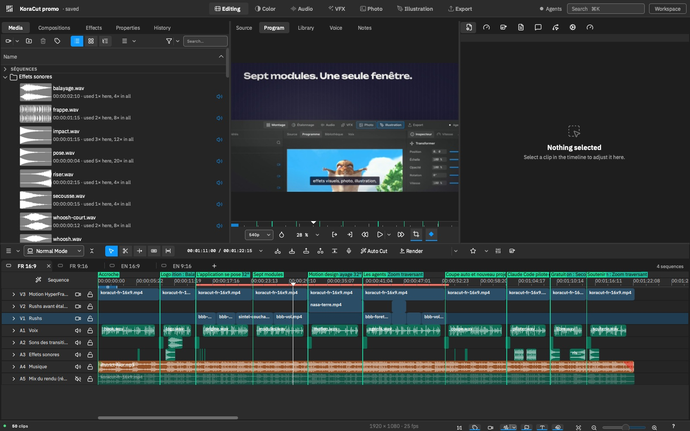

<p align="center">
  
</p>

<p align="center">
  <b>The free, open-source video editor your AI agent can drive.</b><br>
  Edit, grade, mix and animate yourself, or ask Claude Code, Codex, Gemini or the model of your choice to do it with you, inside the timeline, one Undo away.
</p>

<p align="center">
  <a href="https://github.com/amadoubaui/koracut/releases/latest"></a>
  <a href="COPYING"></a>
  
  
  
  <a href="https://github.com/amadoubaui/koracut/stargazers"></a>
</p>

<p align="center">
  <a href="https://koracut.org/en"><b>Website</b></a> ·
  <a href="https://koracut.org/telecharger"><b>Download for macOS</b></a> ·
  <a href="#edit-with-your-ai-agent">AI agents</a> ·
  <a href="#build-from-source">Build</a> ·
  <a href="CONTRIBUTING.en.md">Contribute</a> ·
  <a href="README.fr.md">Version française</a>
</p>



## Why KoraCut

Most editors bolt an AI button onto a closed app. KoraCut goes the other way: it is a complete desktop editor (built on the solid foundations of Kdenlive and MLT) where **every action is also a tool an agent can call**. You keep your account, your model and your files. Your rushes never leave your computer.

- **One window, seven modules**: Editing, Color, Audio, VFX, Photo, Illustration, Export, with Motion design inside the timeline.
- **Agents that edit for real**: 126 tools (cut, trim, place, grade, mix, subtitle, animate, export), each call is one step in the undo history. You watch the agent work in the timeline.
- **Bring your own agent**: 15 command line agents are supported out of the box, from Claude Code, Codex CLI and Gemini CLI to OpenCode, Aider and goose. KoraCut writes their instructions, connects them and launches them in a window that stays open even if the app closes.
- **MCP server included**: `koracut-ctl mcp` exposes KoraCut to any Model Context Protocol client, no Node.js needed.
- **Made for modest machines first**: light proxy copies, adaptive preview, a machine profile chosen at first launch, so editing stays smooth on 4 cores and 8 GB.

## What you can do today

| Module | What it does |
|---|---|
| **Editing** | Multi-sequence timeline, sequences side by side, DaVinci-style shortcuts, auto-cut of silences and filler words, script panel linked to the timeline, subtitles |
| **Color** | Node-based grading (wheels, curves, qualifier, windows, LUT, color space transform), the same grade in preview and in the export |
| **Audio** | Mixer, loudness normalization to platform targets, voice cleanup (RNNoise), music ducking, voice effects, AI voice-over |
| **Motion design** | HTML + GSAP compositions ([HyperFrames](https://github.com/heygen-com/hyperframes)) rendered straight into the timeline, animated titles and transitions |
| **VFX** | Stabilization, subject cut-out to pass elements behind a person (macOS), privacy blur that follows a phone or a name |
| **Export** | A delivery page with 25 presets (YouTube, Shorts, TikTok, Instagram Reels, LinkedIn, WhatsApp status, ProRes masters…) and a render queue |
| **Photo, Illustration** | In progress |

## Edit with your AI agent

1. Open or save your project, then choose **Edit with an Agent**.
2. Pick your agent (Claude Code by default). KoraCut writes its instructions in the project folder, connects it to the running app and opens it in its own terminal window.
3. Ask in plain words: *"Cut the silences of the interview, put the music under it at -18 LUFS, and add a title at the start."*
4. Every change lands in the timeline. One Undo takes back a whole turn of the agent.

From any terminal, the same doors are open:

```bash
koracut-ctl timeline etat niveau=resume          # read the timeline
koracut-ctl timeline outil nom=couper_clip args='{"clip_id": 21, "position": "00:00:04:00"}'
koracut-ctl mcp                                   # MCP server over stdio
```

Agents never touch your media with ffmpeg or a script behind your back: they edit inside KoraCut, through its tools, or they stop and say what is missing.

## Download

- **macOS** (Apple Silicon): [koracut.org/telecharger](https://koracut.org/telecharger), or in one line: `curl -fsSL https://koracut.org/telechargements/installer-mac.sh | bash`. The package is not notarized yet; the download page explains how to open it.
- **Windows and Linux**: Windows builds and passes the test suite in CI, Linux builds and passes it in a container; packages are coming. Leave your address on the website to hear about them.

Each release ships with the exact source archive, as the GPL requires. See [Releases](https://github.com/amadoubaui/koracut/releases).

## Build from source

Qt 6.10 or newer, KDE Frameworks 6.21 or newer, MLT 7.38 or newer, KDDockWidgets 2.4 and CMake. Details per system: [dev-docs/build.md](dev-docs/build.md).

```bash
cmake -B build -DCMAKE_BUILD_TYPE=RelWithDebInfo
cmake --build build
```

On macOS the studio toolchain goes through KDE Craft. A build without the agents: `-DKORACUT_AGENTS=OFF`.

Packaging: Flatpak (`.flatpak-manifest.json`, [notes](packaging/flatpak/README.md)), Snap (`snapcraft.yaml`), Windows with MSYS2 (`packaging/koracut-msys2.sh`), Linux with all dependencies (`packaging/koracut-lnx-withalldeps.sh`).

## Contributing

Bug reports, ideas and pull requests are welcome: [CONTRIBUTING.en.md](CONTRIBUTING.en.md). If KoraCut is useful to you, a star on this repository helps other editors find it.

## License and origin

GPL v3. Full text in `COPYING`, component licenses in `LICENSES/`. Copyright © 2026 PIXEWORK, Dakar.

KoraCut is derived from a free video editor published under GPL v3: https://invent.kde.org/multimedia/kdenlive. The original code, its authors and its license are preserved. Copyright holders are listed in `AUTHORS` and in the SPDX headers of the source files.
